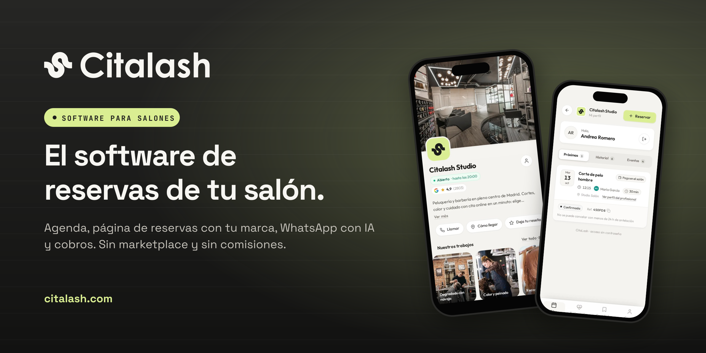

 

### El software de reservas y gestión para peluquerías, barberías y centros de estética

[citalash.com](https://citalash.com) · [Precios](https://citalash.com/#precios) · [Seguridad](https://citalash.com/seguridad) · [contacto@citalash.com](mailto:contacto@citalash.com)

---

**Citalash no es un marketplace.** Es la plataforma profesional que devuelve a cada salón el control de su negocio, sus clientes y su marca.

- **Su propia página de reservas**, con su logo y su enlace, abierta 24/7.
- **WhatsApp con IA** que contesta, confirma y mueve citas mientras el equipo trabaja.
- **Agenda, equipo, TPV, tratamientos y facturación** en un solo panel, en el móvil y en el ordenador.
- **La app de sus clientes**: cada cliente tiene su perfil con sus citas, bonos y recordatorios.
- **Sin comisiones** por cliente nuevo y sin permanencia.

Hecho en España para salones de España.
